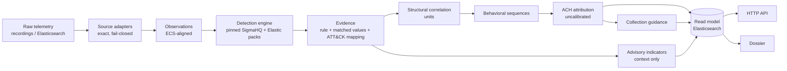

# SOC APT Attribution Platform

An end-to-end system that turns raw security telemetry into **explainable, evidence-based APT
attribution**: telemetry from Windows, Linux, macOS, cloud / SaaS and network sensors is normalised,
matched against pinned detection content, mapped to MITRE ATT&CK®, correlated into units of related
behaviour, reconstructed into attack sequences, and compared against every active ATT&CK Group and
Campaign — with every conclusion traceable back to the raw record that supports it.

It is a personal research and portfolio project, governed by [CLAUDE.md](CLAUDE.md): never fabricate
functionality, never hard-code an attribution, explain every conclusion, measure instead of assuming.

## What makes it different

- **Attribution is evidence-driven, not label-driven.** Candidates come from ATT&CK's own `uses`
  relationships; each observed technique carries its diagnosticity (`g` = share of active Groups using it,
  `D = 1 − g`); hypotheses are compared with an ACH matrix and an explicit *unattributed* baseline
  ([ADR-0005](docs/architecture/adr/0005-attribution-engine-specification.md)).
- **No confidence without calibration.** Until a calibration corpus passes its readiness gate, the system
  emits **no** likelihood, confidence or ranking — only the documented quantities
  ([ADR-0006](docs/architecture/adr/0006-calibration-corpus-and-versioning.md),
  [ADR-0009](docs/architecture/adr/0009-read-model-api-v1.md)). The gate exists and is honestly *not
  yet met* (it needs isolated-lab recordings of more actors).
- **It says what to look for next.** For every unit, *evidence-collection guidance* lists the unobserved
  techniques that would separate the remaining candidates (`k` of `n` use it), ATT&CK's data components for
  observing them, and whether this platform can detect them today
  ([ADR-0005 Amendment E](docs/architecture/adr/0005-attribution-engine-specification.md)).
- **Correlation that cannot be fooled by containers.** Units are formed only by structural facts — same
  process instance, parent/child lineage, injection, same audit event — never by "same host" or "same
  user" alone ([ADR-0003](docs/architecture/adr/0003-correlation-and-behavioral-chain-layer.md)).
- **Threat-intel kept in its place.** Government-advisory indicators (pinned, hash-verified STIX) are shown
  beside a unit with the publisher's own attribution sentence — and are proven, by test, to change no
  attribution quantity ([ADR-0013](docs/architecture/adr/0013-indicator-intelligence-layer.md)).
- **An attribution dossier** per investigation answers, in plain language and from the persisted read model
  only: what was observed, what evidence was extracted, which techniques are supported and why, which actors
  are consistent, what uncertainty remains, and what evidence would help.
- **Reproducible by test.** Every investigation is run in fresh interpreters under different hash seeds and
  must persist byte-identical documents (a real order-dependence was found this way and fixed).

## Pipeline



## Telemetry supported (each validated on real public data)

| Family | Sources | Real data used |
|---|---|---|
| Windows | Sysmon (events 1, 3, 5, 7, 8, 10, 11, 12, 13, 15, 17–23); Windows Security (32 events: logons, Kerberos, services, tasks, account changes, object access, WFP …); PowerShell 4103 / 4104; System log service installs (7045) | OTRF Security-Datasets (APT29 evaluation, APT3, LSASS campaigns) |
| Linux | Sysmon for Linux; Linux Audit (raw `audit.log`) | Splunk `attack_data` |
| Cloud / SaaS | Entra ID, Office 365, AWS CloudTrail, Azure Activity, Okta, GitHub audit, Kubernetes audit | Splunk `attack_data` |
| Network | Zeek (JSON and TSV) | OTRF Zeek logs of the corpus runs |
| macOS | Endpoint Security process events via osquery | Splunk `attack_data` |

Every dataset is pinned by commit or URL and verified by hash; manifests live beside the data under
[`data/telemetry-samples/`](data/telemetry-samples/). Decisions and measurements per family:
[ADR-0008](docs/architecture/adr/0008-telemetry-source-formats.md), [0010](docs/architecture/adr/0010-linux-telemetry.md),
[0011](docs/architecture/adr/0011-cloud-telemetry.md), [0012](docs/architecture/adr/0012-network-telemetry.md),
[0014](docs/architecture/adr/0014-macos-telemetry.md).

## Coverage (measured, not claimed)

From the generated [coverage report](data/detection/sigma/r2026-07-01/generated/coverage-summary.md),
against ATT&CK Enterprise v19.2, SigmaHQ `r2026-07-01` and Elastic `detection-rules` @ `195f15c0`:

- **1,913** Sigma rules imported (plus 78 partial), mapped to **344** ATT&CK ids; every rejected rule is
  listed with its reason (telemetry gap, untranslatable construct, policy).
- **514** Elastic prebuilt rules translated exactly (488 whole, 26 partial) for Sysmon, Windows
  Security, PowerShell script blocks, AWS CloudTrail, Microsoft 365, Entra ID, Azure activity logs, Okta, GitHub and
  Kubernetes telemetry, mapped to 303 ATT&CK ids — **68 not covered by Sigma**
  ([ADR-0015](docs/architecture/adr/0015-elastic-prebuilt-rules.md)). Every ECS field they read is
  reproduced from Elastic's own ingest pipeline for that source and checked against Elastic's own
  pipeline test fixtures — down to the Java `HashMap` key order of CloudTrail's request parameters, and
  the tokeniser Elasticsearch applies to PowerShell script text (phrase matches are token-exact).
  21 of them are multi-event rules: thresholds fire only for events close enough to be counted
  together under any rule schedule, and "new terms" rules only when the recording itself holds the
  history the rule compares against (Amendment C).
- **404 of 697** active techniques are covered, and **322 of 498** of those used by active Groups (336
  and 276 with Sigma alone); **163 of 176**
  active Groups have at least two covered techniques (the minimum to attribute at all).
- Uncovered techniques are classified, not hidden: no Sigma rule exists, a telemetry gap blocks it, or ATT&CK
  lists no platform this system has telemetry for.

### How these numbers are measured, and what they do not say

Every figure above is read from a generated report, regenerated by a script and checked by a test that it
reproduces byte for byte: `data/detection/sigma/r2026-07-01/generated/*.import-report.json`,
`data/detection/elastic/195f15c0bac8/generated/*.import-report.json` and `coverage-report.json`. Figures in older
documents and commit messages (for example 440 Elastic rules, 395 techniques) are earlier states of the same
reports, not a different way of counting.

- **A rule is counted** when every branch (whole) or at least one branch (partial) of the source rule translates
  exactly. A partial rule can only miss, never fire more widely than its author wrote.
- **A technique is "covered"** when at least one counted rule maps to it. It does not mean the technique has been
  detected in real data: that has been shown only for the techniques that fire on the recordings under
  `data/validation`.
- **A Group is identified** only by an artefact of its own tooling: 36 reviewed rules, for 15 Groups. For 3 more
  Groups the only path is a match with an indicator a government advisory attributes to them. That is reported as
  an **advisory indicator lead**, a third party's attribution to verify — never as an identification — because
  addresses, domains and even files are reused.
- **The known-answer check is a demonstration, not an accuracy figure.** Four public lab recordings, all used
  throughout development (none held out): two emulations (APT29, APT3) — not real intrusions — and two single tool
  runs with no actor. "Correct" means the verdict names the known actor and no other. Result: APT29 named, from one
  match of one rule (a service name published in reporting on its tooling); APT3 not named; the two no-actor
  recordings left unnamed; no wrong name. By behavioural overlap alone the true actor is never first (positions
  15–125), which is why overlap is shown as similarity only.
- **Integrations: built versus exercised.** Wazuh alerts have been read only from sample alerts in the documented
  format, not from a running manager. The Kibana dashboard charts investigations run from the command line with
  `--elasticsearch`; recordings uploaded through the console are not exported to it. The AI analyst has answered
  real questions with a local model, correctly but slowly (two to four minutes each on a laptop CPU).

## Honest limitations

- **Calibration is pending.** Likelihood and confidence need recordings of at least four actors made in an
  isolated lab ([lab recording guide](docs/operations/lab-recording-guide.md)); until then results are
  explicitly *uncalibrated*.
- **Public data is thin for some families.** Linux and cloud recall on the public datasets is low because
  Sigma lacks single-event rules for many of their behaviours; Zeek rules fire on none of the corpus traffic;
  public macOS data yields only low-level detections. All of this is measured and recorded in the ADRs.
- **Network ↔ host linking is not adopted**: in the available data the sensor and host clocks disagree, and
  estimating an offset would be inference, not evidence ([ADR-0012](docs/architecture/adr/0012-network-telemetry.md)).

## Running it

Requires **Python 3.12**.

```bash
python -m venv .venv
source .venv/Scripts/activate        # Windows Git Bash;  .venv/bin/activate on macOS/Linux
pip install -e ".[dev]"

# investigate a pinned corpus recording or your own archive (.zip / .tar.gz / .jsonl / .log)
python -m attribution_platform.investigation otrf-apt3-empire --dossier dossier.md --serve
# intake check for a new recording, and the reproducibility check
python scripts/check_recording.py path/to/recording.zip
python scripts/check_reproducibility.py path/to/recording.zip
```

`--serve` starts the read-model API on `127.0.0.1:8000` (`/api/investigations`, `/api/units/{id}`,
`/api/units?technique=`) and, once the frontend is built, the analyst console at the same address. Several
recordings can be given in one session. `--elasticsearch` persists to and serves from Elasticsearch instead of
memory (see below). Recording archives come from `scripts/acquire_corpus_telemetry.py` (git-ignored cache, tracked
manifests).

### The analyst console

A web console over the API ([ADR-0016](docs/architecture/adr/0016-analyst-frontend.md),
[ADR-0021](docs/architecture/adr/0021-behavioural-profile-match-and-response.md)): an overview, investigations
with their attack sequence, ATT&CK matrix and timeline
([ADR-0019](docs/architecture/adr/0019-investigation-views-and-ran-versus-detected.md)), and for each one:

- **Attribution** — the Group identified by evidence specific to it, or the closest behavioural profiles ordered
  by overlap (rare techniques weigh more), grouped into the clusters the evidence cannot separate, with an overlap
  matrix. Overlap is a stated similarity measure, not a confidence: the Methodology page gives the formula and the
  validation results.
- **Attack chain** — tactics in the order they were first observed, with the process sequences behind them; and
  **Indicators** — hashes, addresses and domains from the detected events, checked against the advisory bundles,
  exportable as CSV ([ADR-0022](docs/architecture/adr/0022-attack-chain-observables-and-analyst-assistant.md)).
- **Response** — MITRE ATT&CK mitigations for the observed techniques, by how many each addresses.
- **AI analyst** — a chat panel answers questions about an investigation and summarises it, from a digest of the
  stored results (never the raw logs). The model is free and runs on this machine through
  [Ollama](https://ollama.com): install Ollama, run `ollama pull llama3.1:8b`, and start the platform. No key, no
  account, nothing leaves the machine. `ATTRIBUTION_ASSISTANT_MODEL` names another pulled model;
  `--no-assistant` turns the panel off.
- **Wazuh alerts** — upload a Wazuh manager's `alerts.json`: each alert's own ATT&CK ids are checked against the
  pinned ATT&CK data and fed into the same attack chain, indicators and group matching
  ([ADR-0023](docs/architecture/adr/0023-wazuh-alerts-as-input.md)).
- **Kibana dashboard** — run an investigation with `--elasticsearch` and import
  `kibana/attribution-dashboard.ndjson` (`python scripts/build_kibana_dashboard.py --install`): detections by
  tactic, technique, host and time, the closest behavioural profiles and the identified groups
  ([ADR-0024](docs/architecture/adr/0024-kibana-dashboard.md)).
- **Threat Actors** — all 176 ATT&CK Groups with techniques, software and the evidence that can identify them.

Requires **Node.js 20+**.

```bash
cd frontend && npm ci && npm run build && cd ..        # once; output in frontend/dist (git-ignored)
python -m attribution_platform.investigation otrf-lsass-01-logonpasswords otrf-apt29-day1 --serve
# open http://127.0.0.1:8000/
```

To investigate your own logs from the browser, start the console empty and use **Upload a Recording**
([ADR-0020](docs/architecture/adr/0020-recording-upload.md)): the file goes through the same intake check and
investigation as the command line, one at a time, and stays on this machine.

```bash
python -m attribution_platform.investigation --serve
```

For a lab recording, add the emulation tool's own report and the console sets what ran beside what was detected,
step by step (a MITRE CALDERA operation report; its command text is never read):

```bash
python -m attribution_platform.investigation my-run.zip --emulation-report my-run-report.json --serve
```

For frontend work, run the API as above and `npm run dev` in `frontend/` (http://localhost:5173, `/api` proxied
to port 8000; set `VITE_API_TARGET` for another address). `npm run typecheck`, `npm test`, `npm run build`.

### Checks

| Task | Command |
|---|---|
| Everything CI runs | `ruff format --check . && ruff check . && mypy && pytest` |
| Tests (2,200+, no Elasticsearch / Docker / network needed) | `python -m pytest` |

> **Windows + Git Bash:** if a `.venv/Scripts/` launcher fails with `Permission denied`, use the module
> form (`python -m mypy`, `python -m pytest`).

## What it concludes, and how that was checked

- **Per investigation, a verdict with reasons** ([ADR-0017](docs/architecture/adr/0017-investigation-attribution-assessment.md)):
  nothing attributable, no actor can be singled out, or a lead. It never names an actor from technique overlap.
- **A Group is named only on evidence specific to it** ([ADR-0018](docs/architecture/adr/0018-actor-specific-evidence.md)):
  Sigma rules associated with one Group — by tag, or filed under the Group's name or under software ATT&CK records
  for that Group alone — count only where a written, per-rule review accepts them (41 of 141). 36 rules are usable
  for 15 Groups; Detection Coverage lists them and every decision. Each rule has a known-answer test: its published
  artefact fires it and names its Group, neutral values fire nothing. On 1.15 M real observations the pack fired
  once: the service name published for APT29's CosmicDuke, in the recording of an APT29 emulation that reproduces
  it — so that recording is now reported as a lead to APT29, and no other recording names anyone.
- **Advisory indicators** ([ADR-0013](docs/architecture/adr/0013-indicator-intelligence-layer.md)): 454 file
  hashes, addresses and domains from seven pinned CISA bundles, each attributed only through the publisher's own
  sentence (Volt Typhoon, APT28, APT29, Andariel, Fox Kitten, Ember Bear). A match is reported as the advisory's
  claim, not the platform's.
- **Known-answer checks** (`data/validation/known-answer-checks.json`, shown on the site): on recordings of APT29
  and APT3 emulations, ordering candidates by technique overlap never put the emulated actor first under 16
  orderings (positions 15–125), and on tool tests with no actor it would still have named one every time. The
  platform's own verdicts named an actor in 1 of the 4 cases — the right one, as a lead — and none wrongly.
- **`scripts/audit_served_read_model.py`** recomputes what a running server states — every rule re-fired on its
  observation, every candidate set rebuilt from ATT&CK — and must pass before a result is trusted.
- **A self-built lab** ([docs/operations/lab-pilot-results.md](docs/operations/lab-pilot-results.md)): an isolated
  two-VM lab recorded a CALDERA run; the platform accepted and analysed it, found the agent's masquerading and
  hidden launches, and — set step by step against CALDERA's own report
  ([ADR-0019](docs/architecture/adr/0019-investigation-views-and-ran-versus-detected.md)) — detected the named
  technique in 3 of 8 steps and has no Evidence for 3 of the 7 techniques that were run. Reported as measured.

Not claimed: a calibrated confidence. No calibration version exists, so none is shown.

## Platform stack (Elasticsearch + Kibana)

[`docker-compose.yml`](docker-compose.yml) brings up a single-node, security-enabled Elasticsearch + Kibana
(Basic / free tier), pinned versions, TLS on, data in a named volume.

```bash
cp .env.example .env             # >= 16 GB host;  .env.constrained.example for 8 GB
docker compose up -d             # setup + es01 + kibana
```

`tests/test_live_elasticsearch.py` (opt-in) runs the same investigations into the real cluster and the
in-memory client and checks the served read models are identical:

```bash
docker compose up -d es01
docker compose cp es01:/usr/share/elasticsearch/config/certs/ca/ca.crt data/cache/es-ca.crt
ATTRIBUTION_LIVE_ELASTICSEARCH=1 ELASTIC_PASSWORD=<from .env> ELASTICSEARCH_CA_CERT=data/cache/es-ca.crt python -m pytest tests/test_live_elasticsearch.py
```

## Repository map

```
src/attribution_platform/
  sources/            telemetry adapters (Windows, Linux, macOS, cloud / SaaS, Zeek) — exact, fail-closed
  domain/             Observation, Evidence, provenance, ATT&CK references
  detection/          rule engine, derived ECS views; detection_content/: Sigma and Elastic importers,
                      field maps, coverage, detectability
  correlation/        structural + contextual correlation, behavioral sequences
  attribution/        candidates, ACH matrix, comparative analysis, collection guidance
  intel/              advisory indicators (context only)
  calibration/        corpus builder and readiness gate
  investigation/      end-to-end runs, read-model records, dossier, CLI
  dataplane/, api/    Elasticsearch persistence and the read-model HTTP API
  replay/             recording reader, routing, intake check
data/                 pinned ATT&CK, Sigma, telemetry samples, intel — each with manifest + NOTICE
docs/architecture/    architecture and 15 ADRs (decisions, measurements, rejected alternatives)
scripts/              acquisition, import, reports, checks — run by a human, never at runtime
tests/                unit, golden real-record, end-to-end and reproducibility tests
```

Start with [docs/architecture/README.md](docs/architecture/README.md) for the ADR index.

## Data attribution

MITRE ATT&CK® data (Enterprise v19.2) is used under the [ATT&CK Terms of
Use](https://attack.mitre.org/resources/terms-of-use/); ATT&CK is a registered trademark of The MITRE
Corporation ([NOTICE](data/attack/enterprise/v19.2/NOTICE.md)). Detection content: SigmaHQ (DRL 1.1);
Elastic detection rules, KQL grammar, ingest pipelines and their test fixtures (Elastic License 2.0,
[NOTICE](data/detection/elastic/NOTICE.md)).
Telemetry: OTRF Security-Datasets (MIT), Splunk `attack_data` (Apache-2.0). Indicators: CISA (public
domain, TLP:CLEAR). Each data directory carries its own NOTICE.
