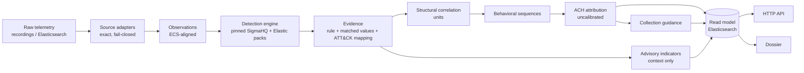

# SOC APT Attribution Platform

An end-to-end system that turns raw security telemetry into **explainable, evidence-based APT
attribution**: telemetry from Windows, Linux, macOS, cloud / SaaS and network sensors is normalised,
matched against pinned detection content, mapped to MITRE ATT&CK®, correlated into units of related
behaviour, reconstructed into attack sequences, and compared against every active ATT&CK Group and
Campaign — with every conclusion traceable back to the raw record that supports it.

It is a personal research and portfolio project, governed by [CLAUDE.md](CLAUDE.md): never fabricate
functionality, never hard-code an attribution, explain every conclusion, measure instead of assuming.

## What makes it different

- **Attribution is evidence-driven, not label-driven.** Candidates come from ATT&CK's own `uses`
  relationships; each observed technique carries its diagnosticity (`g` = share of active Groups using it,
  `D = 1 − g`); hypotheses are compared with an ACH matrix and an explicit *unattributed* baseline
  ([ADR-0005](docs/architecture/adr/0005-attribution-engine-specification.md)).
- **No confidence without calibration.** Until a calibration corpus passes its readiness gate, the system
  emits **no** likelihood, confidence or ranking — only the documented quantities
  ([ADR-0006](docs/architecture/adr/0006-calibration-corpus-and-versioning.md),
  [ADR-0009](docs/architecture/adr/0009-read-model-api-v1.md)). The gate exists and is honestly *not
  yet met* (it needs isolated-lab recordings of more actors).
- **It says what to look for next.** For every unit, *evidence-collection guidance* lists the unobserved
  techniques that would separate the remaining candidates (`k` of `n` use it), ATT&CK's data components for
  observing them, and whether this platform can detect them today
  ([ADR-0005 Amendment E](docs/architecture/adr/0005-attribution-engine-specification.md)).
- **Correlation that cannot be fooled by containers.** Units are formed only by structural facts — same
  process instance, parent/child lineage, injection, same audit event — never by "same host" or "same
  user" alone ([ADR-0003](docs/architecture/adr/0003-correlation-and-behavioral-chain-layer.md)).
- **Threat-intel kept in its place.** Government-advisory indicators (pinned, hash-verified STIX) are shown
  beside a unit with the publisher's own attribution sentence — and are proven, by test, to change no
  attribution quantity ([ADR-0013](docs/architecture/adr/0013-indicator-intelligence-layer.md)).
- **An attribution dossier** per investigation answers, in plain language and from the persisted read model
  only: what was observed, what evidence was extracted, which techniques are supported and why, which actors
  are consistent, what uncertainty remains, and what evidence would help.
- **Reproducible by test.** Every investigation is run in fresh interpreters under different hash seeds and
  must persist byte-identical documents (a real order-dependence was found this way and fixed).

## Pipeline



## Telemetry supported (each validated on real public data)

| Family | Sources | Real data used |
|---|---|---|
| Windows | Sysmon (events 1, 3, 5, 7, 8, 10, 11, 12, 13, 15, 17–23); Windows Security (32 events: logons, Kerberos, services, tasks, account changes, object access, WFP …); PowerShell 4103 / 4104 | OTRF Security-Datasets (APT29 evaluation, APT3, LSASS campaigns) |
| Linux | Sysmon for Linux; Linux Audit (raw `audit.log`) | Splunk `attack_data` |
| Cloud / SaaS | Entra ID, Office 365, AWS CloudTrail, Azure Activity, Okta, GitHub audit, Kubernetes audit | Splunk `attack_data` |
| Network | Zeek (JSON and TSV) | OTRF Zeek logs of the corpus runs |
| macOS | Endpoint Security process events via osquery | Splunk `attack_data` |

Every dataset is pinned by commit or URL and verified by hash; manifests live beside the data under
[`data/telemetry-samples/`](data/telemetry-samples/). Decisions and measurements per family:
[ADR-0008](docs/architecture/adr/0008-telemetry-source-formats.md), [0010](docs/architecture/adr/0010-linux-telemetry.md),
[0011](docs/architecture/adr/0011-cloud-telemetry.md), [0012](docs/architecture/adr/0012-network-telemetry.md),
[0014](docs/architecture/adr/0014-macos-telemetry.md).

## Coverage (measured, not claimed)

From the generated [coverage report](data/detection/sigma/r2026-07-01/generated/coverage-summary.md),
against ATT&CK Enterprise v19.2, SigmaHQ `r2026-07-01` and Elastic `detection-rules` @ `195f15c0`:

- **1,883** Sigma rules imported (plus 75 partial), mapped to **344** ATT&CK ids; every rejected rule is
  listed with its reason (telemetry gap, untranslatable construct, policy).
- **251** Elastic prebuilt rules translated exactly (237 whole, 14 partial) for Sysmon telemetry, mapped
  to 209 ATT&CK ids — **26 not covered by Sigma**
  ([ADR-0015](docs/architecture/adr/0015-elastic-prebuilt-rules.md)). Every ECS field they read is
  reproduced from Elastic's own ingest pipeline and checked against Elastic's own pipeline test fixtures.
- **293 of 498** techniques used by active Groups are covered (276 with Sigma alone); **163 of 176**
  active Groups have at least two covered techniques (the minimum to attribute at all).
- Uncovered techniques are classified, not hidden: no Sigma rule exists, a telemetry gap blocks it, or ATT&CK
  lists no platform this system has telemetry for.

## Honest limitations

- **Calibration is pending.** Likelihood and confidence need recordings of at least four actors made in an
  isolated lab ([lab recording guide](docs/operations/lab-recording-guide.md)); until then results are
  explicitly *uncalibrated*.
- **Public data is thin for some families.** Linux and cloud recall on the public datasets is low because
  Sigma lacks single-event rules for many of their behaviours; Zeek rules fire on none of the corpus traffic;
  public macOS data yields only low-level detections. All of this is measured and recorded in the ADRs.
- **Network ↔ host linking is not adopted**: in the available data the sensor and host clocks disagree, and
  estimating an offset would be inference, not evidence ([ADR-0012](docs/architecture/adr/0012-network-telemetry.md)).

## Running it

Requires **Python 3.12**.

```bash
python -m venv .venv
source .venv/Scripts/activate        # Windows Git Bash;  .venv/bin/activate on macOS/Linux
pip install -e ".[dev]"

# investigate a pinned corpus recording or your own archive (.zip / .tar.gz / .jsonl / .log)
python -m attribution_platform.investigation otrf-apt3-empire --dossier dossier.md --serve
# intake check for a new recording, and the reproducibility check
python scripts/check_recording.py path/to/recording.zip
python scripts/check_reproducibility.py path/to/recording.zip
```

`--serve` starts the read-model API on `127.0.0.1:8000` (`/investigations`, `/units/{id}`, `/units?technique=`);
`--elasticsearch` persists to and serves from Elasticsearch instead of memory (see below). Recording
archives come from `scripts/acquire_corpus_telemetry.py` (git-ignored cache, tracked manifests).

### Checks

| Task | Command |
|---|---|
| Everything CI runs | `ruff format --check . && ruff check . && mypy && pytest` |
| Tests (2,200+, no Elasticsearch / Docker / network needed) | `python -m pytest` |

> **Windows + Git Bash:** if a `.venv/Scripts/` launcher fails with `Permission denied`, use the module
> form (`python -m mypy`, `python -m pytest`).

## Platform stack (Elasticsearch + Kibana)

[`docker-compose.yml`](docker-compose.yml) brings up a single-node, security-enabled Elasticsearch + Kibana
(Basic / free tier), pinned versions, TLS on, data in a named volume.

```bash
cp .env.example .env             # >= 16 GB host;  .env.constrained.example for 8 GB
docker compose up -d             # setup + es01 + kibana
```

`tests/test_live_elasticsearch.py` (opt-in) runs the same investigations into the real cluster and the
in-memory client and checks the served read models are identical:

```bash
docker compose up -d es01
docker compose cp es01:/usr/share/elasticsearch/config/certs/ca/ca.crt data/cache/es-ca.crt
ATTRIBUTION_LIVE_ELASTICSEARCH=1 ELASTIC_PASSWORD=<from .env> ELASTICSEARCH_CA_CERT=data/cache/es-ca.crt python -m pytest tests/test_live_elasticsearch.py
```

## Repository map

```
src/attribution_platform/
  sources/            telemetry adapters (Windows, Linux, macOS, cloud / SaaS, Zeek) — exact, fail-closed
  domain/             Observation, Evidence, provenance, ATT&CK references
  detection/          rule engine, derived ECS views; detection_content/: Sigma and Elastic importers,
                      field maps, coverage, detectability
  correlation/        structural + contextual correlation, behavioral sequences
  attribution/        candidates, ACH matrix, comparative analysis, collection guidance
  intel/              advisory indicators (context only)
  calibration/        corpus builder and readiness gate
  investigation/      end-to-end runs, read-model records, dossier, CLI
  dataplane/, api/    Elasticsearch persistence and the read-model HTTP API
  replay/             recording reader, routing, intake check
data/                 pinned ATT&CK, Sigma, telemetry samples, intel — each with manifest + NOTICE
docs/architecture/    architecture and 15 ADRs (decisions, measurements, rejected alternatives)
scripts/              acquisition, import, reports, checks — run by a human, never at runtime
tests/                unit, golden real-record, end-to-end and reproducibility tests
```

Start with [docs/architecture/README.md](docs/architecture/README.md) for the ADR index.

## Data attribution

MITRE ATT&CK® data (Enterprise v19.2) is used under the [ATT&CK Terms of
Use](https://attack.mitre.org/resources/terms-of-use/); ATT&CK is a registered trademark of The MITRE
Corporation ([NOTICE](data/attack/enterprise/v19.2/NOTICE.md)). Detection content: SigmaHQ (DRL 1.1);
Elastic detection rules, KQL grammar and Sysmon pipeline fixtures (Elastic License 2.0,
[NOTICE](data/detection/elastic/NOTICE.md)).
Telemetry: OTRF Security-Datasets (MIT), Splunk `attack_data` (Apache-2.0). Indicators: CISA (public
domain, TLP:CLEAR). Each data directory carries its own NOTICE.
