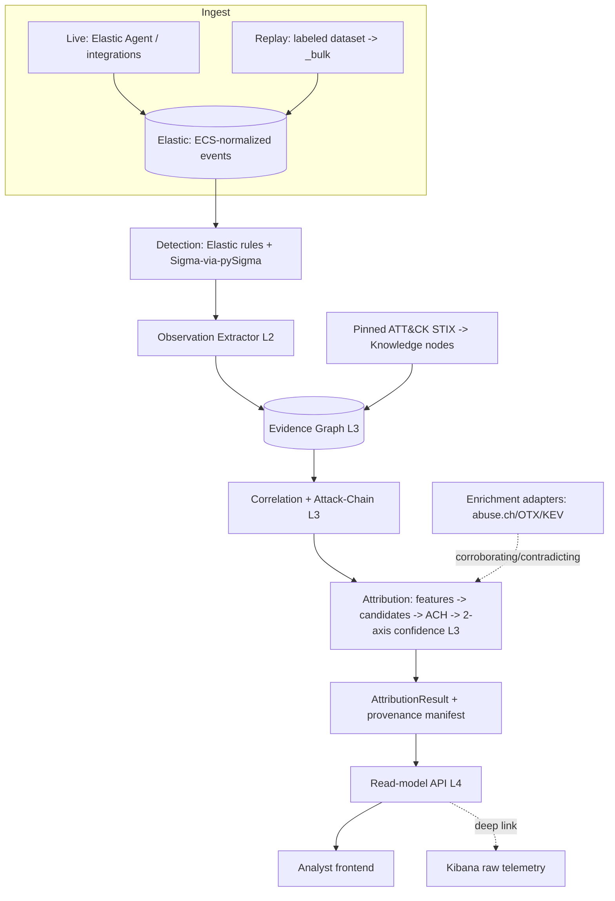

# 03 — System Data Flow (Recommended Architecture)

**Status: PROPOSED.** Describes how data moves through Option B end-to-end, in both **live** and
**offline-replay** modes, and how **provenance is preserved at every hop**. Companion:
[02 recommended](02-recommended-architecture.md), [04 boundaries](04-component-boundaries.md).

## Two ingestion modes, one downstream pipeline

The single most important data-flow decision: **live and replay modes converge immediately after
ingestion**, so everything downstream (extraction → graph → correlation → attribution) is identical and
therefore reproducible.



## Stage-by-stage: object in → object out → provenance kept

| # | Stage | Input | Output | Provenance recorded |
|---|---|---|---|---|
| 1 | Ingest | raw telemetry / dataset | ECS events in Elastic | Elastic `_index/_id`, dataset content-hash |
| 2 | Detection | ECS events | rule matches (Elastic alerts) | rule id/version, matched event ids |
| 3 | Extraction (L2) | rule matches | `Observation` (entities, fields, ts) | → source `Event` ids, rule id |
| 4 | Technique assertion | `Observation` + ATT&CK | `Observation --supports(w)--> Technique` | → `Observation`, → `Technique`, matched fields as *why* |
| 5 | Feature build | `TechniqueAssertion` set | `BehavioralFeature` vector (weighted) | → contributing assertions |
| 6 | Correlation | `Observation`s | `AttackChain` (tactic-ordered) | → observation ids + each edge's link reason (shared entity/time) |
| 7 | Candidate generation | features + ATT&CK `uses` | `Candidate` set (Groups/Campaigns) | → techniques that implicated each candidate |
| 8 | Evidence linking | candidates + all evidence | `EvidenceLink`s (supports / **contradicts**) | → the specific assertion/IOC + weight + source grade |
| 9 | ACH | evidence × candidates | ranked `Hypothesis` set | → evidence links per hypothesis |
| 10 | Confidence | hypotheses | two-axis (likelihood + confidence) | → inputs to each axis (weights, coverage, contradictions) |
| 11 | Result assembly | hypotheses + manifest | `AttributionResult` | → **all** of the above + version manifest |
| 12 | Serve/render | result | API JSON → UI views | ids preserved so UI can drill to raw events |

**Key invariant:** at stage 12 an analyst can click any conclusion and walk *back* through 11→…→1 to the
exact raw events. No node exists without a provenance edge to its inputs. This is the architectural
enforcement of CLAUDE.md principles 3, 4, and 6 (evidence-based, explainable, traceable path).

## Provenance manifest (attached to every result)

```
{
  attack_version:      "<pinned attack-stix-data release>",
  dataset:             "<name>@<content-hash>",     // or live-window descriptor
  detection_ruleset:   "<elastic-rules ver> + <sigma set@hash>",
  engine_version:      "<git commit>",
  generated_at:        "<utc>",
  determinism_hash:    "<hash of canonical result>"  // same inputs => same hash
}
```

## Live vs. replay — what differs

| Aspect | Live mode | Replay mode |
|---|---|---|
| Source | Elastic Agent/integrations | dataset → `_bulk` |
| Use | lab demos, exploratory hunting | tests, validation, reproducible results, CI |
| Time | wall-clock windows | dataset-relative windows (deterministic) |
| Reproducible? | best-effort | **yes** (pinned + hashed) — this is the mode that gates "done" |

## Where Elastic's native correlation fits (not discarded, but not the final word)

Elastic **EQL `sequence`** output is consumed at **stage 6 as an input signal** (candidate links between
observations), then re-expressed in our own `AttackChain` object with explicit, inspectable edge reasons.
We do not treat Elastic's sequence result as the finished, explained chain — the explanation and ordering
are ours, so they can be tested and shown. (Elastic Attack Discovery is used only offline as a comparison
baseline, never in this flow.)

## Failure / empty-path behavior (boundary honesty)

- No detections → no observations → an empty `AttributionResult` that *says so*, with a coverage note ("no
  telemetry for tactics X/Y") — never a fabricated attribution.
- Ambiguous evidence → multiple hypotheses at "roughly even chance," not a forced single answer.
- Enrichment source down → hypothesis stands on behavioral evidence; the missing corroboration is recorded,
  not silently dropped.
